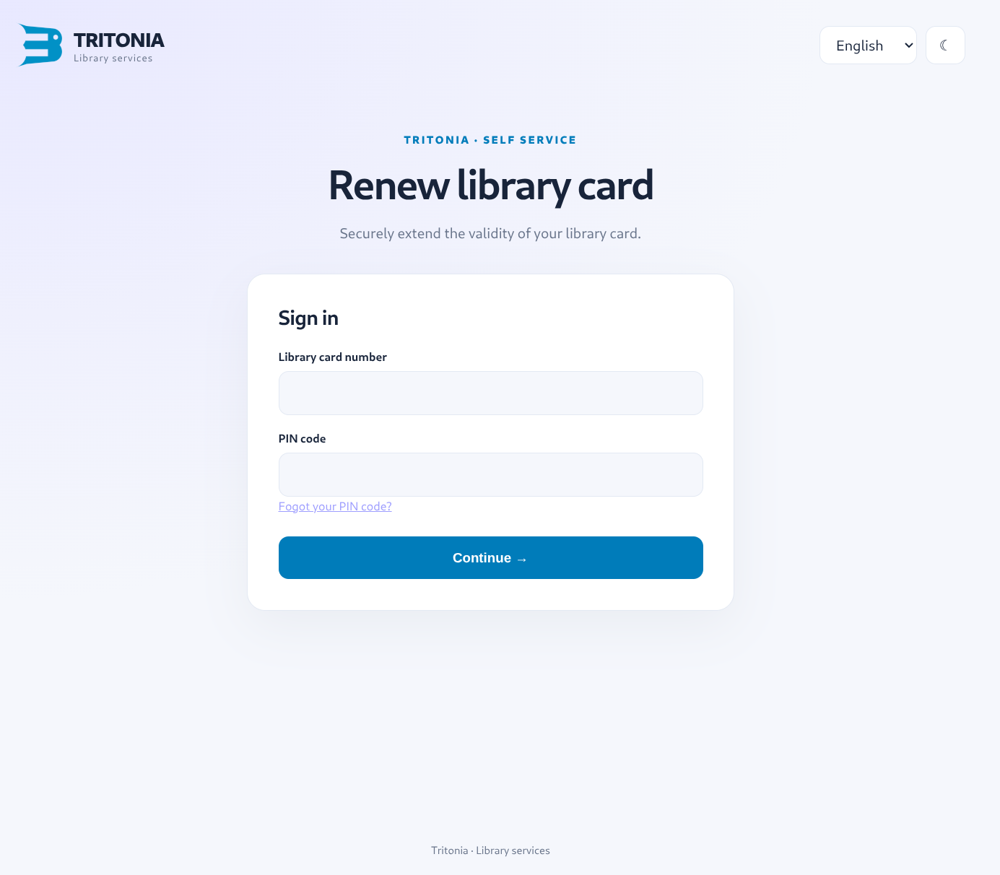
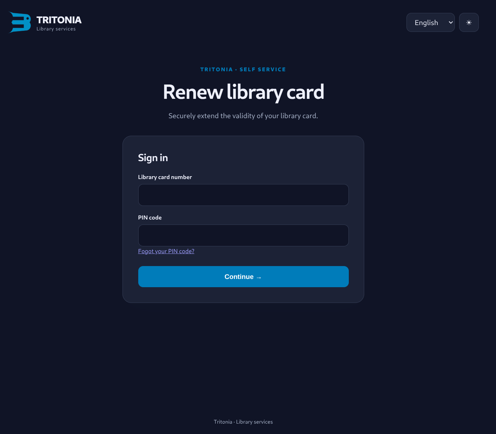

# Tritonia Koha Library Card Renewal Webapp

[](https://doi.org/10.5281/zenodo.24195095)

<table>
  <tr>
    <td width="50%" align="center"><strong>Light Mode</strong></td>
    <td width="50%" align="center"><strong>Dark Mode</strong></td>
  </tr>
  <tr>
    <td>
      
    </td>
    <td>
      
    </td>
  </tr>
</table>

A PHP 8.2+ web application for renewing Tritonia library cards through the Koha 26.05 REST API.

The application provides a Finnish, Swedish, and English interface, light and dark themes, library card and PIN authentication, email-based one-time password (OTP) verification, and 1-, 2-, and 5-year renewal options.

**Deployment status:** The Koha API operations and SMTP gateway acceptance have been tested separately. Complete end-to-end testing, eligibility checks, and security review must be completed before public access is enabled.

## Features

- Finnish, Swedish, and English user interface
- Light and dark themes
- Library card number and PIN authentication
- Koha REST API integration with OAuth2 client credentials
- Six-digit email OTP, valid for 15 minutes, with a maximum of five incorrect attempts
- One-, two-, and five-year renewal options
- Configurable maximum expiry date and server-side rate limiting
- Demo and production modes

## Requirements

- PHP 8.2 or newer
- Apache HTTP Server with PHP-FPM and HTTPS
- Outbound HTTPS connectivity to the Koha REST API
- A working mail transport for PHP `mail()`
- Koha OAuth2 client credentials with appropriate permissions
- A protected, writable `storage/` directory

No separate PHP development server or dedicated TCP listener is needed.

## Installation

Deploy the application within an existing Apache VirtualHost, for example:

```text
/var/www/html/webapp-folder/
```

The entry point is `index.php`. Ensure PHP-FPM is enabled and Apache processes the included `.htaccess` rules. The application must be served over HTTPS.

Protect configuration files and credentials from unauthorized access and version control.

## Configuration

Configure `src/config.php` for the deployment. Relevant settings include:

| Setting | Purpose |
| --- | --- |
| `mode` | `demo` or `production` |
| `koha_base_url` | Koha API base URL |
| `koha_client_id`, `koha_client_secret` | OAuth2 client credentials (keep secret) |
| `koha_token_path` | OAuth2 token endpoint |
| `koha_password_path` | PIN validation endpoint |
| `koha_patron_path` | Patron record endpoint |
| `renewal_method` | Koha expiry-update method |
| `sender_email` | Visible sender email address |
| `max_expiry_years_from_today` | Maximum permitted expiry date |
| `otp_ttl_seconds` | OTP validity in seconds |
| `session_ttl_seconds` | Session validity in seconds |

Example configuration (replace placeholders with deployment-specific values):

```php
'mode' => 'demo',
'koha_base_url' => 'https://koha.example.org',
'renewal_method' => 'put_expiry_date',
'sender_email' => 'library@example.org',
'max_expiry_years_from_today' => 10,
'otp_ttl_seconds' => 900,
'session_ttl_seconds' => 900,
```

Do not publish live endpoints, credentials, or environment-specific mail settings.

## Koha REST API integration

The following endpoints have been tested individually against the configured Koha environment:

- `POST /api/v1/oauth/token` — obtain an OAuth2 access token
- `POST /api/v1/auth/password/validation` — validate the patron PIN
- `GET /api/v1/patrons/{patron_id}` — retrieve the patron record
- `PUT /api/v1/patrons/{patron_id}` — update the expiry date with required patron fields
- `GET /api/v1/patrons/{patron_id}` — verify the updated expiry date

The `PUT` method is used because `PATCH` was not supported in the tested environment.

**Important:** Updating `expiry_date` directly is not necessarily equivalent to Koha's complete membership-renewal workflow. Patron eligibility, restrictions, debt, renewal authorization, and library policy must be validated before public use.

## Email and OTP

The application sends a six-digit verification code to the patron's email address. The OTP is valid for 15 minutes and allows a maximum of five incorrect attempts.

## Demo mode

Set `mode` to `demo` in `src/config.php`.

- Library card: `1234567890`
- PIN: `12345`

Demo mode displays the OTP on screen and does not modify Koha records.

## Security

- Use HTTPS for all production traffic.
- Restrict application access during integration testing.
- Keep `src/config.php`, backups, Git metadata, and `storage/` inaccessible over HTTP.
- Ensure Apache is configured to honor the relevant `.htaccess` restrictions, or configure equivalent VirtualHost rules.
- Prefer moving configuration and storage outside the public DocumentRoot when practical.
- Ensure only the PHP service account has the necessary storage write access.
- Do not commit OAuth2 secrets, OTP data, or other sensitive information.

## Project structure

| Path | Purpose |
| --- | --- |
| `index.php` | HTTP entry point |
| `assets/style.css` | Styling and themes |
| `assets/app.js` | Client-side functionality |
| `assets/img/logo.svg` | Tritonia logo |
| `src/core.php` | Application and Koha integration logic |
| `src/config.php` | Configuration and secrets |
| `storage/` | Rate-limiting and application data |
| `.htaccess` | Apache access restrictions |
| `.gitignore` | Exclusions for local files and secrets |

The bundled `assets/img/logo.svg` is used in both light and dark modes.

## Release status — v1.0

Version 1.0 documents the implemented Koha and email integrations and the existing multilingual renewal interface. The following acceptance checks remain before public release:

1. Test the complete browser workflow with an authorized Koha test patron.
2. Verify OTP delivery and confirmation.
3. Confirm renewal eligibility and library policy enforcement.
4. Verify date calculations and renewal limits.
5. Complete a security review and controlled acceptance test.

## Production Validation

**Version:** 1.0.0  
**Validation date:** 13 November 2026  
**Environment:** AlmaLinux 9, Apache HTTP Server, PHP-FPM, Koha REST API

The application was successfully tested in its production environment on 13 November 2026.

The following functionality was verified through an end-to-end library card renewal:

- Patron authentication using a library card number and PIN.
- Email delivery of the one-time password (OTP).
- Successful OTP verification.
- Completion of the library card renewal process.
- Updating the patron's expiration date through the Koha REST API.
- Independent confirmation of the updated expiration date in Koha.

**Result:** All tested functions completed successfully. The application's core library card renewal workflow was verified in the production environment.

This validation confirms the tested workflow but does not constitute a comprehensive security audit or performance assessment.

## AI transparency

See [AI-TRANSPARENCY.md](AI-TRANSPARENCY.md) for information about AI-assisted development and documentation.

## Trademark and Branding

The Tritonia name and logo (`assets/img/logo.svg`) are the property of Tritonia and/or their respective rights holders.

The Tritonia logo is included solely for identification and branding purposes and is **not covered by the MIT License**.

No permission is granted to reproduce, modify, redistribute, or otherwise use the Tritonia name or logo independently of the application without authorization from the respective rights holders.

## Citation

If you use this software in research, teaching, or other projects, please cite:

Päivärinta, J. (2026). *Tritonia Koha Library Card Renewal Webapp* (Version 1.0.0) [Computer software]. Zenodo. https://doi.org/10.5281/zenodo.24195095

**DOI:** [10.5281/zenodo.24195095](https://doi.org/10.5281/zenodo.24195095)

## License

The source code of this project is licensed under the MIT License.

Copyright (c) 2026 Jani Päivärinta

See the [LICENSE](LICENSE) file for details.

The MIT License does not apply to third-party trademarks, logos, or other materials identified as excluded from the license. See [Trademark and Branding](#trademark-and-branding).
